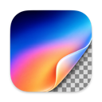

<div align="center">
  
  <h1>Compositor</h1>
  <p><strong>A free, open-source image editor for compositing and photo work.</strong></p>
  <p>Layers, masks, retouching, Camera Raw, and animated GIFs.</p>
  <p>
    <a href="https://chiddekel.github.io/Compositor/">Download for Linux</a> ·
    <a href="https://robbietilton.com/compositor">Download for macOS</a> ·
    <a href="docs/project-format.md">Documentation</a> ·
    <a href="https://github.com/chiddekel/Compositor/issues">Report an issue</a>
  </p>
  <p>
    <a href="LICENSE"></a>
    
    <a href="https://github.com/chiddekel/Compositor/actions/workflows/ci-guard.yml"></a>
  </p>
</div>

Compositor is built around a familiar, layer-based editing workflow: combine images, refine masks,
adjust color, and export the finished composition. Projects keep layers and edits available for later work.

This repository maintains the **GNU/Linux port** of [Robbie Tilton's Compositor](https://github.com/robbietilton/Compositor).
It runs the upstream Swift editor through a macOS API compatibility layer, with Qt providing the Linux host
and Skia providing raster drawing. Linux releases are **x86_64 alpha builds**; report Linux issues in this repository.

[Install](#installation) · [Features](#features) · [Build](#building-from-source) · [Test](#testing) · [Contribute](#contributing) · [Docs](#documentation)

## Installation

### GNU/Linux

Install [Flatpak](https://flatpak.org/setup/) for your distribution, then install the signed alpha:

```sh
flatpak install --user https://chiddekel.github.io/Compositor/com.compositor.Client.flatpakref
flatpak run com.compositor.Client
```

The install reference adds the `compositor-alpha` update repository. Use **Check for Updates…** in the app,
your software center, or:

```sh
flatpak update com.compositor.Client
```

See [Flatpak releases](docs/flatpak-releases.md) for bundles, updates, and release details.

### macOS

Download the original app from [robbietilton.com/compositor](https://robbietilton.com/compositor)
or [upstream releases](https://github.com/robbietilton/Compositor/releases/latest), or use Homebrew:

```sh
brew install --cask robbietilton-compositor
```

Requires **macOS 26 or later on Apple silicon**. macOS builds and support come from the upstream project.

## Features

| Workflow | Tools |
| --- | --- |
| Compositing | Layers and folders, blend modes, clipping masks, editable effects |
| Selection and masking | Marquee, lasso, Magic Wand, object and subject selection, feathering |
| Painting and retouching | Pressure-sensitive brush, healing, clone stamp, blur, editable text and shapes |
| Color and filters | Camera Raw, Levels, Curves, adjustment layers, blur, grain, glow |
| Animation | GIF layers, frame editing and playback, saved timing, animated export |
| Files and canvas | PSD/PSB import, camera RAW, SVG/PDF, project tabs, guides, image and canvas resizing |

<details>
<summary><strong>Full feature reference</strong></summary>

### Layers

- Layers and folders, with opacity and Photoshop's full set of blend modes in its order — a folder's opacity dims everything inside it
- Layer masks: paint, fill, invert, blur and feather them anywhere on the canvas, past the layer's own pixels; link or unlink them to transform a mask on its own
- Clipping masks and folder masks
- Adjustment layers: Hue/Saturation, Levels, Curves, Exposure, Gradient Map, Grain, Black & White, Color Balance, Invert, and filter layers: Gaussian Blur, Motion Blur, Progressive Blur, Noise, Vignette, Bloom / Glow, RGB Split, Lens Effects and Tonal Contrast
- Layer effects: Stroke, Drop Shadow, Color Overlay, Inner Shadow, Outer Glow and Inner Glow, rendered on the GPU and editable at any time
- Merge Down, Merge Layers and Merge Group (⌘E)
- Duplicate, rename inline, reorder and nest by drag and drop; Option-drag to duplicate; a right-click menu in the Layers panel
- Copy and paste whole layers and folders (⌘C/⌘V with no selection), within a project or between projects, or drag them between projects

### Transform

- Non-destructive move, scale, rotate and flip — images keep their full resolution however small you make them
- Free distort (⌘-drag a handle), with Shift to lock to an axis
- Transform several layers, or a whole folder, together
- Snapping to canvas and layer edges and centers, with guides
- Exact values for position, size, scale and angle, stepped with the arrow keys
- Flip Layer and Flip Canvas, horizontal and vertical

### Selections

- Rectangle and Ellipse Marquee, Freehand and Polygonal Lasso, and the Magic tool — Wand selects by color, Object traces whatever you click (Tab switches)
- Select Subject, and Expand, Contract and Feather on any selection
- Add to and subtract from selections, move the outline, or move and duplicate the pixels inside
- Load a layer's pixels or a mask as a selection
- Content-Aware Fill, which can also extend an image past its edges

### Painting and retouching

- Brush with size, hardness, opacity and smoothing, in Paint or Erase mode (B and E), and Shift for straight lines
- Pen pressure for the Brush's size and opacity, on a graphics tablet
- Spot Healing Brush (content-aware)
- Clone Stamp, aligned or not, sampling one layer or all of them
- Blur tool, on pixels or masks
- Gradient tool and Shape tool (rectangles, rounded rectangles, ellipses and lines), which stay editable rather than being rasterized
- Type tool (T): inline multiline editing in draggable, resizable paragraph boxes; font, size, color, alignment and spacing in the tool header; transform text and use it as a clipping mask
- Eyedropper and a full color picker

### Adjustments and filters

- Camera Raw filter: light, color, curves, color mixer, color grading, detail, optics and geometry, in a panel beside the canvas; each section resets to its defaults from its header
- Levels (with Auto), Curves, Hue/Saturation, Exposure, Gradient Map, Grain, Black & White, Color Balance and Invert
- Gaussian Blur and Motion Blur that spread past a layer's edges
- Add Noise, Vignette, Bloom / Glow, Dither, Scanlines, RGB Split, Lens Effects (anamorphic flare, starburst, mist, prism and bokeh in round, hexagon, oval or cat's-eye shapes), Tonal Contrast, Lens Correction and Remove Background
- Live previews, limited to the selection when there is one
- Last Filter (⌃⌘F) runs the last filter again with the same settings

### Canvas and files

- Multiple projects in tabs
- Search Commands (⌘F): find every menu command and tool by name, as in Raycast or Obsidian, and run it with Return
- Toggle Fullscreen (F): the canvas alone on black over the whole screen, with every panel put away; F or Esc brings them back
- Rulers (⌘R), guides dragged from them, a layout grid with adjustable spacing and subdivisions, and Snap To for guides, grid, layers and document bounds
- Crop with snapping, ratios including 3:4 and 9:16, and Option for symmetric cropping; with a selection, the crop starts at it
- Canvas Size, Image Size and Trim
- The tool bar moves into two columns when the window is too short for one
- A Navigator minimap in the canvas's corner from 300% zoom: the whole document in small with a box around the view; click or drag to move there (View › Navigator)
- Sharp high-quality downsampling when zoomed out, and a pixel grid when zoomed in
- Import JPEG, PNG, HEIC, TIFF, WebP, SVG, PDF (every page its own layer, at 300 DPI or fitted to the canvas), animated GIF (one layer whose frames show in a strip under the canvas, to play, paint on, duplicate, delete and retime), camera RAW (with a develop step first) and Photoshop PSD and PSB (8-bit RGB; not CMYK). Each Photoshop artboard opens in a tab of its own; folders, masks, blend modes, fill rectangles/ellipses, and simple horizontal text stay editable; other vectors and vertical text become pixels. A conversion report is shown before anything is applied.
- Large documents: the memory budget scales with your Mac, and a Photoshop file too big to open has its layers cropped to the canvas instead
- Export PNG (⇧⌘E), Export JPEG (⇧⌥⌘S), and Export As (⇧⌥⌘W) for PNG, JPEG, a one-page PDF at the print size or, with a GIF layer, an animated GIF, scaled if you like, with a live preview, JPEG quality and file size; Channel Pack in Export As packs layers into a PNG's red, green, blue and alpha for game textures, and RGB Split's Split to Layers turns a layer back into those four; Copy Merged
- Keep working while a project saves
- Photoshop-style keyboard shortcuts throughout, remappable in Edit > Keyboard Shortcuts
- Drag a number's label to scrub its value, as in Photoshop
- Automatic updates, signed and notarized

### Works with AI agents

- AI agents and scripts can build and edit projects directly: a `.comp` is a folder of PNG layers and a manifest, and an open project updates live as it's written. See [Writing Compositor projects](docs/writing-comp-files.md)

</details>

The feature reference describes the upstream editor. For platform-specific behavior and verification,
see the [compatibility inventory](docs/current-linux-compatibility-inventory.md) and
[macOS/Linux parity inventory](docs/mac-linux-parity-inventory.md).

## Building from source

### GNU/Linux

Requires `git`, `flatpak`, and `flatpak-builder`. The manifest selects the KDE 6.11 SDK and Swift 6
extension; its SDK and runtime versions must match.

```sh
git clone https://github.com/chiddekel/Compositor.git
cd Compositor
flatpak remote-add --user --if-not-exists flathub https://flathub.org/repo/flathub.flatpakrepo
flatpak-builder --user --install --install-deps-from=flathub --force-clean \
  build-dir com.compositor.Client.yaml
flatpak run com.compositor.Client
```

The first build compiles the pinned native dependencies. Source archives, checksums, and license notices
are included; see [vendored Linux dependencies](docs/vendored-linux-dependencies.md).

Once the SDK and native bridges are prepared, the [development launcher](scripts/run-compositor.sh)
builds and runs the working tree:

```sh
./scripts/run-compositor.sh --release
./scripts/run-compositor.sh --release --offscreen --session-smoke
```

### macOS

Requires Xcode 26 or later. Open `Compositor.xcodeproj` and run the **Compositor** scheme, or:

```sh
xcodebuild -project Compositor.xcodeproj -scheme Compositor \
  -destination 'platform=macOS' build
```

## Testing

Run the fast upstream source, generator, and override checks from the repository root
(with the `upstream` remote fetched):

```sh
git remote add upstream https://github.com/robbietilton/Compositor.git  # once per clone
git fetch upstream main
bash scripts/check-upstream-clean.sh
```

The Linux contract runner needs the manifest's dependency modules, Skia, and the Qt image-codec backend.
Prepare a separate SDK build directory before the final packaging cleanup, then run:

```sh
flatpak-builder --user --force-clean --disable-rofiles-fuse --stop-at=compositor \
  build-test com.compositor.Client.yaml
flatpak build --device=dri --filesystem="$PWD" build-test \
  bash "$PWD/scripts/linux-contract-tests.sh"
```

See the [Linux test baseline](docs/upstream-test-baseline.md) for backend environment variables and
focused test commands. On macOS, run the **CompositorTests** target in Xcode.

## Contributing

Bug reports and focused pull requests are welcome. Include your app version, distribution,
steps to reproduce, and whether you used a packaged Flatpak or a development build.

For Linux changes, extend `Sources/Compat/` before adding an override. Keep protected upstream app
and test sources unchanged; put platform implementations behind the existing interfaces.
See [AGENTS.md](AGENTS.md) and [platform abstraction](docs/platform-abstraction.md) for repository rules
and the SOLID service boundaries.

The upstream editor is English-only and is not currently accepting localization pull requests.

## Documentation

| Guide | Contents |
| --- | --- |
| [Platform abstraction](docs/platform-abstraction.md) | macOS APIs, Linux implementations, and replaceable services |
| [Compatibility inventory](docs/current-linux-compatibility-inventory.md) | Current Linux coverage and limitations |
| [Upstream integration](docs/upstream-after-1.4.10-ledger.md) | Commit coverage, platform adaptations, and verification references |
| [Source map](docs/linux-port-file-map.md) | Reused sources and platform replacements |
| [Override manifest](linux/upstream-parity.json) | Every override and its purpose |
| [Test exclusions](linux/UPSTREAM_TEST_EXCLUSIONS.md) | Platform-only upstream tests and their reasons |
| [Project format](docs/project-format.md) | The `.comp` document format |
| [Writing projects](docs/writing-comp-files.md) | Create and edit projects with scripts or AI agents |
| [Desktop previews and render parity](docs/render-parity-and-desktop-previews.md) | File-manager integration and platform comparisons |
| [Flatpak releases](docs/flatpak-releases.md) | Linux packaging, updates, and publishing |

<details>
<summary><strong>macOS release tooling</strong></summary>

`scripts/release.sh` creates a signed, notarized DMG in `dist/`. It requires a Developer ID Application
certificate, notarization credentials stored as `compositor-notary`, and
[`create-dmg`](https://github.com/create-dmg/create-dmg). Keep signing credentials outside the repository.

</details>

## Credits and license

Compositor was created by [Robbie Tilton](https://github.com/robbietilton).
The [upstream repository](https://github.com/robbietilton/Compositor) maintains the original macOS application.
Other community ports are listed in its platform discussions:
[Windows](https://github.com/robbietilton/Compositor/issues/23) and
[Linux](https://github.com/robbietilton/Compositor/issues/19).

Released under the [MIT License](LICENSE). Third-party dependency notices are documented in
[vendored Linux dependencies](docs/vendored-linux-dependencies.md).
